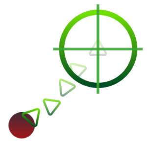

# Path Prediction Algorithm

## What is this Project?

It's a semi vibe coded **target path prediction algorithm**, with 2d and 3d visualization.
It represent a situation where a turret predicts a drone's movement.

This was done as a side project.
Only python has been used.